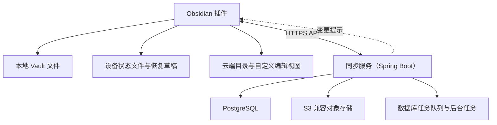

# Self-hosted LiveSync 云端笔记重写：开发方案与实施计划

- 日期：2026-10-22
- 更新：2026-10-23；将端到端加密纳入首版默认范围，并同步相关协议、搜索、恢复与工期约束。
- 更新：2026-10-24；服务端技术基线由 Go 调整为 Java（Spring Boot），服务端详细设计见[服务端设计：Java / Spring Boot 基线](server_design_java_zh.md)。
- 状态：设计提案；本文不表示功能已经实现。
- 现有代码基线：Self-hosted LiveSync 1.0.39，Commonlib 0.1.44。
- 工作基线：TypeScript / Svelte 插件、Java（Spring Boot）服务端、PostgreSQL，以及 S3 兼容对象存储。
- 文档语言：按本次需求使用中文，保留代码标识与准确的产品名称。

## 1. 目标和已确认约束

重写为支持本地文件与云端笔记混合管理的 Obsidian 插件。新协议无需兼容现有 Self-hosted LiveSync 客户端；以用户现有 Vault 文件建立新远端，不要求迁移旧数据库和旧修订历史。

1. 支持 Windows、macOS、Linux、Android，以及 iOS；iPadOS 纳入移动端验证。
2. 产品客户端仅保留 Obsidian 插件，不交付独立 CLI、WebApp 或 WebPeer。
3. 服务端以 PostgreSQL 为本方案的数据库基线，替代原 CouchDB 后端；MongoDB 不作为首版并行后端。
4. Markdown 正文、附件、大文件，以及保留的内容历史均放对象存储。
5. PostgreSQL 保存身份、目录、Metadata、版本关系、权限、对象引用，以及同步记录。原始正文不写入文件 Metadata。
6. 不使用 PouchDB、SQLite 或 IndexedDB 构建本地数据库或完整内容镜像。
7. 允许插件保存必要的本地状态文件、未提交草稿、待上传内容，以及可恢复操作记录。这不等于完全无本地持久化。
8. 每台设备可以独立选择一篇笔记保留本地副本，或仅从云端打开。
9. 本地副本使用 Obsidian 原生编辑器；云端笔记使用插件自定义视图。
10. 数据安全优先：不以最后上传时间或设备修改时间静默覆盖竞争性修改。
11. 正文、附件与历史内容默认客户端端到端加密后上传；服务端不持有明文主密钥。标题、目录与标签的隐私模式由用户在创建 Vault 时明确选择。

## 2. 范围与交付边界

### 2.1 首个完整版本

- 管理员初始化、设备配对、凭据撤销、Vault 隔离。
- 云端目录、标题与路径搜索、云端 Markdown 编辑与预览。
- 本地文件双向同步、草稿保护、断线重试、历史与冲突处理。
- 本地副本与仅云端模式转换。
- 对象存储附件、分段上传、下载与明确的缓存管理。
- 统一笔记列表、稳定笔记链接、删除与恢复。
- 单机部署、数据库迁移、备份恢复、诊断、配额，以及监控。
- 覆盖所有支持平台的验收报告。
- 默认 E2EE、加密草稿、跨设备解锁、恢复密钥、口令变更与密钥版本管理。

### 2.2 不纳入首版的建议项

以下是控制首版复杂度的范围建议，不代表这些能力没有价值：旧客户端互通、旧修订导入、P2P、实时多人光标协作、独立网页客户端、公开分享、细粒度团队协作、OCR、全文附件检索，以及自动同步整个 `.obsidian`。

首版正文编辑以 Markdown 源码编辑与预览为边界，不承诺复刻 Obsidian Live Preview。原生图谱、原生全文搜索，以及第三方插件对仅云端笔记的完整支持也不列为默认承诺。

端到端加密已纳入首版基线，不能作为开发末期附加功能。P0 冻结具体密码库、参数、流式格式和元数据隐私配置；服务端明文全文搜索不纳入本基线。

## 3. 用户模型与术语

| 概念 | 定义 |
| --- | --- |
| Vault | Obsidian 本地目录，以及其绑定的服务端逻辑笔记空间；两个实体分别有标识 |
| 笔记身份 `noteId` | 一篇笔记的固定 ID，改名、移动、模式转换均不改变 |
| 修订 `revisionId` | 不可变的业务版本，不沿用 CouchDB `_rev` |
| 当前版本 `headRevisionId` | 服务端当前展示的主分支修订；不意味着其他分支可以删除 |
| 对象 `blobId` | 对象存储中已验证内容的身份，与正文逻辑路径分离 |
| 操作 `operationId` | 客户端持久化后生成的幂等请求标识 |
| 本地副本 | Vault 中的实际文件，有准确的已反映版本记录 |
| 仅云端 | 不在 Vault 内生成正文文件；打开后内容位于内存，未提交编辑另有恢复草稿 |
| 私有草稿 | 未获得服务端提交确认的内容，不应作为已保存的云端版本展示 |
| 同步游标 | 某个 Vault 历史代次中已经可靠应用的变更位置 |

服务端使用稳定 ID；路径和标题是可修改属性。新协议的修订定义与现有项目术语中的 PouchDB 修订不同，不能混用。

### 3.1 保存位置与同步状态分离

首版纳管笔记有两种设备级保存方式：`materialised` 和 `cloudOnly`。原有普通本地文件在用户选择导入前不纳管，不因扫描而自动上传。

同步状态独立表示：`clean`、`dirty`、`uploading`、`offlinePending`、`conflicted`、`error`。模式转换另外有自己的状态机，不塞入单一布尔变量。

同一篇笔记在电脑保留本地文件，在手机仅云端打开，是正常组合。本设备移除本地副本不能命令其他设备移除副本。

## 4. 总体架构



### 4.1 插件模块

- `ObsidianHost`：生命周期、Vault API、命令、设置与移动端适配。
- `NoteCatalogue`：分页目录、当前会话索引、路径和 ID 解析。
- `SyncCoordinator`：拉取、推送、暂停、重试、代次隔离，以及并发控制。
- `LocalStateStore`：状态文件、日志、草稿、校验与恢复。
- `VaultProjection`：远端修订到本地文件的安全反映与来源记录。
- `CloudEditor`：编辑、预览、草稿恢复、保存状态与远端更新提示。
- `RevisionManager`：版本读取、差异、冲突及历史恢复。
- `PlacementManager`：下载本地副本、移除本地副本、转换日志与恢复。
- `AttachmentManager`：上传、引用、下载、缓存、配额与回收。
- `LinkResolver`：稳定链接、相对路径、歧义、删除与离线状态。
- `CryptoSession`：解锁、密钥分层、对象加解密、草稿保护、自动锁定与恢复；通过窄接口供其他模块使用，不暴露可导出的主密钥。

模块通过窄接口组合；资源所有者明确提供取消与释放能力，不引入新的全能 Core 对象。共享状态集中在一个有明确生命周期的所有者内。

### 4.2 服务端模块

- HTTP API、鉴权、设备管理、Vault 授权。
- 笔记目录、路径校验、修订提交与冲突分支。
- 对象上传会话、完整性验证、提交和下载授权。
- 持久化变更记录、目录快照、同步提示。
- 索引、历史保留、对象回收、诊断和备份任务。

首版是一个模块化的单体服务（Spring Boot 实现，详细设计见[服务端设计](server_design_java_zh.md)），后台任务与 API 可在同一程序运行。任务状态存在 PostgreSQL；暂不引入 Redis、消息中间件、独立搜索集群或微服务。

## 5. PostgreSQL 数据模型

以下是逻辑模型，正式建表 SQL 和索引通过独立迁移文件交付。所有资源引用都必须验证属于同一 Vault，不能只按全局 ID 查询。

| 表 | 关键字段及用途 |
| --- | --- |
| `users` | 管理员及用户身份；首版默认单用户自托管，不开放注册 |
| `vaults` | `id`、所有者、协议版本、`epoch`、事务型 `last_change_seq`、配额、加密策略 |
| `devices` | Vault 成员设备、名称、撤销状态、最近确认游标；复制 Vault 后重新配对 |
| `device_tokens` | 令牌摘要、设备、权限、到期与撤销；不保存可直接使用的令牌明文 |
| `notes` | `id`、Vault、当前修订、冲突状态、删除状态、Metadata 版本；按隐私模式保存可读 Metadata 或加密 Metadata 与受控索引令牌 |
| `note_revisions` | `id`、笔记、正文 `blob_id`、作者设备、操作 ID、字节数、类型、服务端时间 |
| `revision_parents` | 子修订与父修订；普通修改一个父版本，合并可有多个父版本 |
| `blobs` | 随机对象键、密文字节数与摘要、格式及密钥版本、受保护内容密钥、`verified` / `committed` / `deleting` 状态；不保存明文摘要 |
| `attachments` | 固定附件 ID、Vault、当前对象引用、删除状态；显示名和媒体类型按隐私策略保护 |
| `revision_attachments` | 修订引用的附件版本，确保历史笔记恢复时附件仍可用 |
| `upload_sessions` | 上传者、目标、长度限制、分段状态、摘要、有效期与完成状态 |
| `operations` | Vault、设备、操作 ID、请求摘要、确定的提交结果；支持响应丢失后查询 |
| `changes` | Vault、epoch、严格发布序号、资源 ID、变更类型及对应 Metadata 版本 |
| `catalogue_snapshots` | 初次同步或失效游标恢复所用的一致目录快照及截止序号 |
| `jobs` | 索引、回收、上传清理与备份核查任务，含租约、重试次数和错误 |
| `search_documents` | 允许服务端索引时的派生索引，带索引所对应修订 ID |
| `vault_key_envelopes` | 口令与恢复密钥各自保护的主密钥包、KDF 标识、salt、受限参数、密钥与格式版本；不存明文密钥 |
| `crypto_policies` | Vault 元数据隐私模式、允许的密码套件、最低版本及密钥迁移状态；不允许服务端静默降级 |

约束要求：

1. `(vault_id, device_id, operation_id)` 唯一；相同操作 ID 配不同请求内容，返回明确错误。
2. Vault 内有效逻辑路径键唯一；删除后的路径重用必须产生新身份，不能混淆旧笔记。
3. 数据库外键及业务校验共同限制跨 Vault 引用，附件和对象不能越权绑定。
4. Metadata 不嵌入正文；搜索索引是可以重建的派生数据。
5. 修订内容不可变。修改、恢复、删除和冲突解决都以明确操作记录。
6. 内容版本与目录 Metadata 版本分离；改名不必复制正文，但需要新的有序变更。
7. 幂等记录与删除记录的保留期覆盖允许客户端重试的窗口。超出窗口的旧操作必须要求重新协调，不能在清理幂等记录后把同一旧请求当作新请求执行。
8. 元数据加密模式不能保留明文标题和完整路径列作为旁路。路径冲突索引使用独立派生密钥生成的 Vault 内令牌，绑定父目录 ID 与规范化名称；数据库只能约束令牌唯一，不能证明密文中的名称符合路径规则，客户端解密后仍需验证。该设计及重命名规则在 P0 形成 ADR。

## 6. 对象存储与版本模型

### 6.1 对象组织

示意地址：`vaults/{vaultId}/objects/{randomBlobId}`。不使用标题、路径、时间或可预测的递增版本作为对象定位依据。下载文件名由元数据提供。

第一版每次有效正文提交保存完整 Markdown 快照，不实现差分链，不依赖对象存储的原生版本功能。业务修订负责版本关系；存储桶版本功能可用作额外运维保护。

正文相同且基线未变时不创建重复修订；但“有意恢复历史内容”是独立操作，即使正文与旧版本相同也产生新修订。第一版不做跨用户全局内容去重。

### 6.2 上传与提交

1. 客户端先加密并持久化待提交快照和操作 ID，再为本次对象准备独立内容密钥与认证上下文。
2. 服务端创建有上限、可到期的上传会话，分配独立对象键。
3. 客户端在上传前加密正文或附件；小文件通过服务代理上传密文，大文件采用可恢复的密文分段 API，由服务端控制对象写入。
4. 结束上传后服务端验证密文实际长度与摘要；不能将客户端自报摘要或仅一次 HEAD 成功视为完整验证。服务端无法验证明文正文，客户端读取时必须另行验证认证标签、格式和解密结果。
5. 完成验证的对象进入封存状态。服务端不提供覆写已封存对象的普通 API。
6. 提交 API 校验对象所有权、会话、基线和权限，在事务中写修订、引用、变更及幂等结果。
7. 返回确定结果后，客户端持久化确认，才清理对应草稿。

不能用对象 ETag 一概代替内容摘要，特别是分段上传。服务端使用经验证的密文 SHA-256 完整性契约，它不能替代客户端的认证解密。明文摘要仅在客户端使用，必要时放入加密清单，不上传为公开去重键。客户端依据加密前的内容证据判断重复，不能因随机密文不同而制造无意义修订。

首版避免给客户端长期对象存储凭据。预签名直传作为后续优化，需要额外证明校验完成后对象不能再次被覆写；不能简单把任意对象键交给提交接口。

### 6.3 失败与回收

- 对象写入失败：不发布修订，保留草稿和重试状态。
- 对象成功但数据库失败：对象暂为未引用，允许查询操作结果或重试。
- 数据库成功但响应丢失：使用同一操作 ID 返回原结果。
- 已提交对象读取失败：显示具体版本不可用，保留现有本地文件，不以空内容替代。
- 上传或回收期间宕机：依赖持久化状态恢复，不依赖内存回调完成提交。

GC 使用数据库状态机与宽限期：先将无受保护引用的对象标记为 `deleting`，禁止新提交引用；再次核对后删除存储对象，再更新记录。当前版本、冲突分支、保留历史、上传会话、活跃快照，以及备份恢复窗口都参与保护。仅有引用计数不足以单独证明可删除。

## 7. 修订、并发与历史

客户端提交带 `baseRevisionId`，服务端根据准确版本比较，不按设备时间选择胜者。

```text
           ┌── r2：设备 A
r1 ───────┤
           └── r3：设备 B
                  ↓
             合并为 r4，父版本为 r2 与 r3
```

首个上传基于当前版本时推进主分支。另一个上传基于旧版本时仍保存内容为冲突分支，响应 `status: conflicted`，不能既提交内容又返回一个无法辨别是否提交的普通失败。

- 同设备多次编辑串行提交；前一提交未确认时，后续草稿仍保留其准确基线。
- 首版冲突可先提供人工选择或编辑合并；保守自动三方合并作为完整版本验收项。
- 找不到共同祖先或祖先正文不可读时，保留冲突，不猜测。
- 自动合并仅处理可证明不竞争的修改；删除与修改竞争时保留双方意图。
- E2EE 下服务端只管理修订拓扑与冲突标记；三方比较、正文合并和历史预览在已解锁客户端执行。合并结果重新加密后提交，服务端不解密。
- 二进制附件不做文本合并，保留双方对象供选择。
- 解决冲突要检查当时观察到的完整分支集合；若又有新分支，重新读取，不能顺手删除新版本。
- 恢复历史以当前观察基线创建新修订；发生并发时同样执行基线检查。
- 标题、路径、删除等 Metadata 操作也有基线版本，避免与正文更新相互覆盖。

历史保留建议初始默认 30 天，并允许用户固定重要修订；这是待确认的产品默认值。任何自动清理在首次发布前必须具备预览、审计和恢复演练。

## 8. 增量同步与游标正确性

### 8.1 持久化记录是权威

插件通过 HTTPS 拉取 `changes`。WebSocket 仅通知“可能有变化”，允许丢失、重复与乱序；重连、回到前台和启动时均主动补拉。

游标包含 Vault、epoch 和已应用序号，由服务端编码。数据库重建或恢复到旧备份后必须改变 epoch，旧游标不可继续使用。

### 8.2 发布顺序

不能直接将 `BIGSERIAL` 的最大值视为已提交水位：并发事务分配序号的先后不等于提交先后，客户端可能跳过迟提交记录。

首版采用每 Vault 的事务型发布锁：上传和内容计算先完成；短事务内先锁 Vault 发布行，再锁笔记等资源，修改状态并增加 `last_change_seq`，写入变更、操作结果并提交。所有发布操作遵循一致的锁顺序，直到提交才释放锁。失败回滚不推进可见游标。

这一方案牺牲单个 Vault 的写入并发，换取明确的提交顺序；个人笔记场景先测量再决定是否优化。

### 8.3 客户端应用与重放

- 按页拉取有上限的变更；应用失败的页不直接越过。
- 先记录应用意图，完成安全文件写入、版本映射或目录处理，再持久化检查点。
- 重复事件可安全重放；重启时检查磁盘内容与来源记录，不能只相信修改时间。
- 远端文件覆盖前检查本地是否仍匹配已反映版本；本地有未上传编辑时保留编辑并进入冲突处理。
- 仅云端笔记的完整目录不要求持久化在本地。内存目录与持久游标必须配对：重启后无目录基线时重新取快照，不能拿空目录从旧游标继续。
- 游标过期返回 `CURSOR_EXPIRED`，获取新快照；先保护本地待处理操作，不能用全量下载覆盖未上传内容。

### 8.4 初次同步

服务端在一致数据库视图中生成可分页、带有效期的目录快照和对应水位。客户端基于该快照建立目录，再接着拉取水位之后的变化。禁止在每一页重新查询不断变化的实时列表却复用同一截止游标。

大目录使用服务端物化快照或等价的可证明方案，不长期持有跨 HTTP 请求的数据库事务。云端正文按需读取，本地副本按用户选择下载。

## 9. 无本地数据库的持久化设计

建议状态目录位于插件专用目录，最终路径与 Obsidian API 能力在 P0 实测后固定。它必须被本插件同步扫描排除；恢复草稿不能被作为普通笔记再次上传。

```text
state/
  identity.json
  checkpoint.json
  manifests/           # 纳管本地文件的 noteId、基线、摘要和保存方式
  journal/             # 待处理上传、下载反映和转换操作
  drafts/              # 云端编辑及待提交的准确内容快照
  recovery/            # 操作中暂存或隔离的文件
```

要求：

- 按记录分文件或分段，不在每次键入时重写全 Vault 大型 JSON。
- 记录具备格式版本、长度、校验、代次和可恢复写入顺序；保留至少一个可读取的旧状态。
- 不把适配器 `rename` 或 `write` 未经测试地宣称为全平台断电原子操作。撕裂写入必须能被检测，重启不得当作已成功。
- 文件操作通过 Obsidian API，运行时公共逻辑不使用 Node.js `fs`、Electron 或原生模块。
- 远端确认丢失时先查操作结果，不能依据本地日志缺失推断云端未提交。
- 若来源状态损坏而用户文件仍在，先保全文件；通过服务器当前版本和可读历史恢复映射，无法证明时显式重新关联或生成冲突。
- 草稿先在本地保护，再上传；显示“本地草稿已保存”与“云端已保存”的不同状态。系统强杀前最后尚未持久化的按键无法承诺零丢失，UI 与测试要标出边界。
- 用户可以主动放弃本地草稿，但退出、注销、升级和清理缓存不得自动删除未确认内容。
- `drafts/`、待上传快照及包含正文的恢复区内容加密保存，锁定后不留下可直接读取的插件临时明文；`manifests/` 与日志中的路径、摘要按所选隐私模式保护。物化的 Vault 文件仍是用户有意保留的明文副本。转换时若须暂时隔离该明文文件，优先保全新编辑，记录状态并完成加密迁移，不能虚称崩溃瞬间没有明文残留。
- 同一物理 Vault 被多个 Obsidian 进程同时写入不作为首版支持场景；不能用只存在进程内的锁伪装成跨进程互斥。
- 移动端后台可能随时停止，只承诺回到前台后恢复，不承诺持续后台同步。

## 10. 云端编辑、列表与搜索

### 10.1 统一列表

插件侧边栏显示完整逻辑目录，支持分页、排序、搜索、状态过滤和右键操作；列表项分别显示保存位置、待上传状态及冲突。大目录使用虚拟列表，不一次下载所有正文。

原生文件列表仍仅显示 Vault 真实文件。不创建空白 Markdown 占位文件，不将它伪装成可直接编辑的完整云端笔记。

### 10.2 自定义编辑器

首版以源码编辑器和 Markdown 预览提供：新建、编辑、自动保存、手动保存、附件插入、历史、冲突、下载本地副本，以及草稿恢复。支持中文输入法、移动软键盘、触控、辅助功能和屏幕旋转。

自动保存建议停输 1～2 秒后提交，同时限制持续输入时的最长草稿持久化间隔；两者分别配置和测试。版本对应准确的内容快照，不对应每次键入。后台切换不作为唯一保存时机。

同一笔记多个视图共用一个会话编辑所有者；远端更新到来时，干净视图可刷新，有本地编辑的视图保持内容并提示合并。不得替用户静默关闭冲突或用网络响应覆盖仍在输入的文字。

插件卸载后，只有云端的笔记不能通过 Obsidian 原生文件功能访问；提供完整 Markdown 与附件导出，不将插件视图作为唯一数据出口。

### 10.3 搜索

- 基础版必备：在允许公开 Metadata 的模式下，服务端提供标题、路径、标签与删除状态搜索；按权限与 Vault 过滤。
- Metadata 加密模式：目录下载后在客户端解密、分页展示与按需索引。若未获取全部目录，搜索必须显示覆盖范围，不能将未获取内容报告为不存在。
- 正文始终 E2EE；首版只搜索客户端已解密内容或用户明确选择临时下载解密的范围，不上传明文、正文摘要或明文分词索引到 PostgreSQL。派生索引带 `indexedRevisionId` 并随锁定清除，首版不建设本地全文数据库。
- 中文检索：单独准备中文、英文、混合标题及正文数据集。P0 比较客户端分词或子串检索，服务端仅处理允许可见的 Metadata；不直接套用英文配置宣称中文搜索完成。
- 删除、权限撤销和模式变化后不允许残留越权搜索结果；摘要也属于敏感内容。

## 11. 链接与附件引用

### 11.1 笔记链接

插件内部链接以 Vault ID 和 `noteId` 定位，不依赖标题。界面展示可读标题；协议处理入口通过正式 Obsidian API 注册，具体 URI 在协议文档中定稿，不在正文写入设备路径、令牌或对象存储签名 URL。

解析顺序：准确 ID → 可证明的逻辑路径与别名 → 展示歧义选择。不能默认取第一篇同名笔记。标题锚点和块引用作为独立目标部分处理。

- 有本地副本时打开原生编辑器；仅云端时打开插件视图。
- 云端视图内处理 `[[wikilink]]`、Markdown 相对链接和嵌入引用。
- 原生视图先提供受支持的插入链接、命令与协议入口；不依赖全局 monkey patch 接管所有第三方链接行为。
- 未解析目标、已删除目标、无权限目标，以及离线不可读取目标分别提示。
- 路径改名保留历史别名映射；旧链接是否批量改写属于可预览、可取消的独立操作。

### 11.2 附件

正文保存稳定附件身份或可解析相对路径，不能保存会过期的签名地址。插件渲染时申请短期下载授权。

云端编辑插入附件时先建立上传会话；正文提交必须关联已经验证的附件版本，或显式保留“附件上传未完成”的草稿状态。下载失败不能将引用替换成空文本。

本地原生 Markdown 使用相对附件文件，第一版在物化笔记时下载其必需的直接附件。大文件的部分缓存、外部播放器与原生嵌入兼容是额外验证项；不能假定所有附件均可透明按需读取。

移除笔记本地副本不自动删除共享附件；先核对其他本地笔记和未提交内容引用。取消下载、清缓存和删除远端附件是三个不同操作。

## 12. 本地与云端转换状态机

### 12.1 云端转本地

`requested → fetching → verified → materialising → recorded → completed`

1. 读取笔记身份、目录 Metadata 版本与正文修订。
2. 检查路径合法性、大小写、Unicode、Windows 保留名及已有文件碰撞。
3. 下载正文和必要附件，校验字节数和摘要。
4. 写入暂存位置，记录转换意图；已有同名用户文件绝不直接覆盖。
5. 重新读取服务端状态。若正文或路径变化，按精确下载版本处理并随后补拉，不能错记为最新版本。
6. 完成本地写入并记录精确来源后，设备保存方式改为 `materialised`。

### 12.2 本地转仅云端

`requested → flushing → remoteConfirmed → quarantining → recorded → completed`

1. 保存编辑缓冲，冻结本篇转换编排，保护当前内容快照。
2. 提交所有待处理修改，查询操作结果并确认远端对应准确内容。
3. 核对本地内容、路径与远端冲突状态；不一致时停止移除。
4. 将文件移到恢复区，核对恢复区实际字节与确认快照。Obsidian 文件 API 不保证外部写入的原子比较删除，因此不能仅靠删除前一次 hash 就声称消除了竞态。
5. 若检测到新编辑，恢复或保留恢复区文件，明确报告，不继续清理。
6. 持久化设备模式及恢复记录后完成；恢复区按宽限期清理，用户可主动恢复。

监听器依据持久化操作来源识别这次文件移除，不能仅使用一个短暂的全局忽略开关。异常退出后先恢复转换状态，再启用普通删除传播。

恢复区用于容错，不意味着云端模式永远保留正文副本；界面显示尚待清理的内容，并提供在转换确认后立即清理的明确操作。

### 12.3 独立的删除语义

- “移除本地副本”：仅影响本设备保存方式。
- “删除笔记”：创建远端删除记录，进入回收站，对其他设备传播。
- “永久删除”：独立高影响操作，检查历史、附件、备份与保留策略。
- 启动发现本地文件缺失时先核对操作日志和用户意图，不能直接推断全局删除。
- 删除与离线编辑并发时保留待处理内容并进入冲突；不自动复活，也不丢弃编辑。

## 13. 路径、安全写入与来源保护

逻辑路径使用 `/` 和明确的 Unicode 规则。服务端路径键采用跨平台保守冲突策略：NFC 与大小写等价路径不能静默共存；物理路径保留原拼写并验证各平台限制。

禁止绝对路径、`..` 越界、NUL、设备保留名、非法组件、别名绕过和未经允许的隐藏目录写入。无法物化的云端笔记保留在云端并显示原因，不暗中改名。

每个本地文件记录最近反映的准确修订及内容证据。收到新修订时，先确认文件仍匹配记录；无法确认时保护文件并请求处理。数据库版本号与文件 mtime 不作为内容相同或编辑基线的证明。

若服务端目录已经改名，本地有未上传修改，应联合处理身份和路径，不将它当作两个独立新文件。跨路径移动先保护目标内容，再处理源文件。

## 14. API 契约草案

所有端点以 `/v1` 为前缀。操作携带身份和协议能力；详细请求、响应和错误模型通过 OpenAPI 定稿。客户端不直接连接 PostgreSQL。

| API | 用途 |
| --- | --- |
| `POST /pairing/exchange` | 交换一次性配对码与设备凭据 |
| `POST /devices/{deviceId}/revoke` | 授权管理员撤销设备与相关会话 |
| `GET /capabilities` | 协议版本、限制、加密与上传能力；客户端必须校验本地最低策略，不能被响应降级 |
| `GET /vaults/{id}/key-envelopes` | 鉴权后读取受保护密钥包，设备在本地解锁 |
| `POST /vaults/{id}/key-envelopes/replace` | 带包版本条件更新口令或恢复包；不接收解密口令和明文密钥 |
| `GET /vaults/{id}/notes` | 分页目录和过滤 |
| `POST /vaults/{id}/snapshots` | 请求一致目录快照 |
| `GET /vaults/{id}/snapshots/{snapshotId}` | 分页读取指定快照 |
| `GET /vaults/{id}/changes` | 按游标读取有序变更 |
| `POST /vaults/{id}/uploads` | 创建受限上传会话 |
| `PUT /vaults/{id}/uploads/{uploadId}/parts/{part}` | 上传分段 |
| `POST /vaults/{id}/uploads/{uploadId}/complete` | 完成并验证对象 |
| `GET /vaults/{id}/uploads/{uploadId}` | 查询分段及完成状态，恢复中断上传 |
| `POST /vaults/{id}/attachments` | 将已验证对象纳管为固定附件身份 |
| `GET /vaults/{id}/attachments/{attachmentId}/content` | 授权获取指定附件版本 |
| `POST /vaults/{id}/notes` | 纳管新笔记 |
| `POST /vaults/{id}/notes/{noteId}/revisions` | 带基线与幂等 ID 提交正文 |
| `PATCH /vaults/{id}/notes/{noteId}` | 条件式修改 Metadata |
| `GET /vaults/{id}/notes/{noteId}/revisions` | 分页历史 |
| `GET /vaults/{id}/notes/{noteId}/revisions/{revisionId}/content` | 授权读取准确版本 |
| `POST /vaults/{id}/notes/{noteId}/resolve` | 带观察分支集合提交合并结果 |
| `POST /vaults/{id}/notes/{noteId}/delete` | 条件式删除 |
| `POST /vaults/{id}/notes/{noteId}/restore` | 恢复删除或历史内容 |
| `GET /vaults/{id}/operations/{operationId}` | 查询未知结果 |
| `GET /vaults/{id}/search` | 按权限查询 Metadata 或派生索引 |
| `POST /vaults/{id}/devices/{deviceId}/checkpoint` | 确认已应用游标；不能以长期离线设备阻止所有回收 |
| `GET /events` | 可选 WebSocket 提示通道 |

确定业务结果包括 `committed` 与 `conflicted`；`duplicate` 标记原结果的幂等重放，仍保留原结果字段。`retryable` 是错误响应的重试属性，不代表成功保存。重要错误包括 `BASE_MISMATCH`、`PATH_COLLISION`、`CURSOR_EXPIRED`、`EPOCH_CHANGED`、`UPLOAD_NOT_VERIFIED`、`OPERATION_ID_REUSED`、`QUOTA_EXCEEDED` 和 `DEVICE_REVOKED`；HTTP 状态与后续动作通过 OpenAPI 明确。网络或 5xx 错误可能发生在提交之后，须查询操作结果或用同一操作 ID 与同一内容重放。

权限检查既发生在上传/下载授权时，也发生在提交时。所有 API 必须限制请求体、分页、并发、上传大小及会话寿命。重试采用退避和抖动；权限错误与不可恢复错误不能无限重试。

## 15. 隐私、鉴权与端到端加密

默认采用 HTTPS、私有存储桶、设备级凭据、撤销机制，以及服务端最小权限。服务端不能仅靠不可猜测对象 ID 实现授权。

配对码短期有效且一次性使用，不承载永久数据库口令。插件只接触服务 API 凭据，不接触 PostgreSQL 密码或 S3 长期密钥。移动端没有可以未经验证假定存在的系统密钥库；凭据保存与备份泄露风险需专门评审。

### 15.1 保护层与威胁边界

正文、附件与历史默认在客户端加密，服务端只保存密文及受保护密钥包。HTTPS 始终启用；数据库和存储桶的静态加密作为额外措施，不能代替 E2EE。

加密主要保护云端内容泄露及未经授权的密文修改，不保护已解锁设备、恶意客户端插件或用户有意物化的明文 Vault。服务端仍可观察部分对象大小、时间、修订关系和访问模式。认证加密能识别篡改，但不能单独证明服务端提供的是最新历史；客户端保存可信检查点并在发现回退时报警，不能承诺消除所有恶意服务端回放和拒绝服务。

### 15.2 密钥分层

```text
加密口令 + 随机 salt + 版本化 Argon2id 参数
    → 口令派生的保护密钥
    → 解锁随机生成的 Vault 主密钥
    → 保护各正文版本与附件对象的独立随机内容密钥

独立高熵恢复密钥
    → 通过单独恢复包解锁同一 Vault 主密钥
```

- 账户登录、设备 API 令牌、加密口令和恢复密钥分别承担不同职责，不相互复用。
- 主密钥及内容密钥由客户端安全随机源生成。主密钥按用途派生独立的包装、Metadata、路径令牌与本地草稿密钥，不把一个密钥用于所有协议用途。
- 口令派生采用成熟的 Argon2id 实现；salt、算法版本及参数随包记录。P0 在低配手机测量解锁延迟和内存后冻结参数；解锁前检查参数上下界，防止恶意参数耗尽内存，也不接受隐式降级。
- 服务端不接收加密口令、明文主密钥或明文内容密钥。口令改变通常只需重新包装同一主密钥；怀疑主密钥泄露则需要产生新密钥并规划对象重新加密，不能等同于改口令。
- 恢复密钥在客户端生成、展示并由用户离线保管，独立包装主密钥。账户密码重置不能解密内容。口令、恢复密钥及可用已解锁设备全部丢失时，服务器无法恢复正文。

### 15.3 正文与大文件格式

小型正文拟采用 AES-256-GCM，通过 Web Crypto 等成熟实现提供认证加密；大附件采用经过验证的流式认证加密库，Libsodium secretstream 为候选。两者的最终库版本、套件标识、限制和测试向量在 P0 固定，不直接拼接底层密码原语发明新协议。

每个不可变对象使用独立内容密钥和安全随机参数，严格保证同一密钥下 nonce 不被复用。版本化格式包含套件、密钥版本、nonce 或流头、受保护内容密钥和认证数据。认证上下文绑定 Vault、笔记或附件、修订、对象身份及格式；相关 ID 必须在加密前确定，并与提交契约一致。

正文与修订的完整性还需要经认证的清单绑定父版本、附件引用和内容证据，客户端不能盲信服务端修改过的修订关系。共享 Vault 对称密钥的成员都具备相应伪造能力，首版不宣称可验证独立作者签名。

流式附件必须认证分段顺序、结束标记和对象身份，拒绝缺段、乱序、拼接和截断。重试重发相同的密文字节；丢失流状态时从安全检查点恢复，或以新密钥和新对象重新开始，禁止用同一 nonce 重新加密不同数据。流式格式不天然等同于任意位置续传，P0 必须验证上传分段与加密状态的恢复契约。

### 15.4 新设备、锁定与撤销

新设备配对只获得服务访问资格；它还需使用加密口令或恢复密钥在本地解锁密钥包，配对码不能暗含可被服务器读取的主密钥。

默认建议每次启动解锁，闲置后自动锁定；便捷解锁仅在验证对应平台的安全存储后提供，不在普通配置里保存明文主密钥。首次解锁前禁止云端正文编辑和需要保护新内容的上传，不能回退到明文。本地明文文件仍可由 Obsidian 编辑，再次解锁时通过扫描协调。

锁定前保护可持久化草稿，停止使用密钥的活动并清理视图及临时索引。密钥不可用时阻止敏感操作，保留现有恢复内容；不能丢弃最后一次编辑以完成锁定。JavaScript 内存无法承诺绝对擦除，应尽量缩短引用寿命而不作过度安全保证。

撤销设备 API 凭据可以阻止后续访问，但不能收回设备已经下载的正文或密钥。若撤销原因是密钥泄露，另行执行密钥轮换；更新新密钥包不能追溯保密旧设备已知内容。

### 15.5 Metadata 隐私与搜索

创建 Vault 时明确选择，推荐界面默认选更私密的 Metadata 加密模式，并解释搜索差异；具体默认文案在 P0 冻结。

| 模式 | 服务端可见信息 | 搜索与约束 |
| --- | --- | --- |
| 正文 E2EE，Metadata 可读 | 标题、路径、标签及约定附件属性 | 服务端可搜索这些字段，不能搜索正文 |
| 正文及 Metadata E2EE | 加密标题与名称、ID、必要拓扑和路径冲突令牌 | 客户端解密目录并搜索；令牌可能暴露名称相等关系，目录图与访问模式不宣称隐藏 |

路径令牌由独立的 Vault 内密钥生成，不使用公开的路径 hash；删除、改名、目录移动和密钥轮换必须保持客户端与数据库唯一约束一致。客户端解密后仍验证路径合法性及令牌一致性。

隐私模式是 Vault 级协议配置，不由各设备随意选择不同模式；改变模式是可恢复、可审计迁移，不能当作普通开关静默上传原先加密的名称。正文始终保持 E2EE，首版不提供静默降级为服务端明文的入口。

### 15.6 本地草稿与备份

插件持久化的私有草稿、待上传内容、解密临时文件及包含敏感内容的状态使用版本化认证加密保护。明文物化文件是独立的用户选择，不能把它也宣称为端到端加密落盘。

本地草稿使用与上传对象分离的密钥用途，绑定设备、笔记及草稿代次。备份携带受保护密钥包和算法参数，但不包含明文恢复密钥；保留历史仍需相应旧密钥版本。GC 不能提前删除保留历史或离线草稿所需的受保护密钥包。

备份恢复、口令变化和密钥轮换都要在持有密钥的客户端验证解密结果。导出明文时明确请求目标位置，不将调试日志、错误报告或搜索摘要作为明文出口。

Markdown 预览、搜索摘要及附件展示要进行 HTML 与 URL 安全处理；禁止执行正文脚本。日志默认不含正文、凭据、签名 URL 或完整私有路径。导出和诊断遵循用户选择及明确的数据范围。

## 16. 部署、运维与数据出口

标准部署：一个 Spring Boot 服务、一个 PostgreSQL，以及外部 S3 存储。没有现成 S3 服务时，可额外部署一个经过测试的 S3 兼容存储组件。HTTPS 可由已有入口或附带的反向代理提供。

交付物包含：

- `compose.yaml` 与最小配置示例；最终固定镜像版本，不用浮动标签作为验收依据。
- PostgreSQL 建表与迁移工具、显式升级步骤、启动兼容性检查。
- 初始化管理员、设备配对与撤销的服务管理入口；它不属于独立笔记 CLI 产品。
- `/healthz` 存活检查、`/readyz` 就绪检查，以及受保护的诊断入口。
- 请求延迟、提交失败、队列积压、对象校验失败、冲突、GC、数据库连接数等指标。
- 结构化日志与请求关联 ID；默认无需 Kubernetes。

备份必须同时覆盖数据库与对象。推荐先生成数据库一致备份及对象引用清单，再固定或复制引用对象；备份期间的 GC 保护与保留窗口须协调，不能只分别执行两个备份命令便宣称一致。

每次恢复在隔离环境核查对象可读取、权限、冲突、目录和修订；恢复旧数据库时更新 epoch。恢复演练是发布门槛。目标 RPO/RTO 根据部署规模在 P0 记录，不能仅凭架构承诺。

提供将选定或全部笔记导出为普通 Markdown 与相对附件目录的能力，输出链接映射与失败清单。E2EE 导出在持有密钥的客户端完成。

## 17. 现有代码的演进策略

### 17.1 先隔离，后移除

新协议与旧协议不能混入同一个运行路径或状态目录。开发期间保持现有入口可验证，新增独立新核心与测试入口；在新版本通过验收后切换产品入口并删除旧实现。

建议为重写版本使用独立插件 ID 和状态命名空间，避免测试包接管现有用户的 Self-hosted LiveSync 设置。正式名称和发布位置在 P0 决定，保留许可证与来源说明。

可复用的候选：Obsidian UI 适配、翻译流程、路径保护经验、真实 Obsidian 测试基础设施，以及冲突回归案例。复用前检查依赖和行为，不机械搬入旧 Core。

Commonlib 仍是现有协议代码的外部权威包。开发期间不建立 `src/lib` 镜像，不添加 `_types` 回退，也不直接补丁安装目录。若需要调整其已有能力，应在独立仓库验证发布产物；新系统不再依赖它时，在明确边界后移除引用。

### 17.2 从现有 Vault 开始

1. 用户选择现有本地 Vault，展示将纳管的文件、附件、忽略目录和路径冲突。
2. 创建新远端 Vault，不重用旧数据库。
3. 客户端分批加密、上传、校验、提交，记录可恢复进度；导入中不删除本地文件，服务端不接收解密口令。
4. 对比数量和密文完整性，并在客户端解密后核对明文长度、摘要及必要的完整读取。
5. 在第二台设备验证下载、编辑、删除、恢复与冲突。
6. 用户确认后才允许批量转为仅云端。

旧远端独有内容必须先通过旧客户端恢复到文件或单独导出。新系统不会自动导入旧 CouchDB 历史。回退入口优先是保留本地文件和新系统导出；旧客户端不能读取新远端。

## 18. 建议目录结构

以下是新系统切换后的目标结构，不表示立即移动现有代码。

```text
src/
  main.ts
  host/obsidian/
  domain/                 # 笔记、修订、冲突与路径规则
  services/               # 同步、状态、附件、模式转换
  transport/              # 协议、鉴权、重试与取消
  ui/                     # 目录、编辑器、设置、历史
  i18n/
server/                        # Spring Boot 单体服务，包结构见服务端设计 §3
  src/main/java/com/isogelun/server/
    api/ auth/ vaults/ notes/ revisions/
    uploads/ objects/ attachments/ sync/
    storage/ search/ jobs/ config/ common/
  src/main/resources/db/migration/   # Flyway 迁移
protocol/
  openapi.yaml
  examples/
test/
  contract/
  integration/
  e2e-obsidian/
  fixtures/
deploy/
docs/
```

保留现有仓库要求的拼写、翻译及测试约定。新协议数据格式使用显式版本，TypeScript 和 Java 对同一契约测试向量运行验证。

## 19. 实施阶段、任务和验收

时间为熟悉相关技术的单名全职工程师的初步有效工作日估算；不含等待设备、外部审查和分发审核。阶段有前置依赖，不将下列区间视作承诺日期。

| 阶段 | 工作包 | 主要交付物 | 退出验收 | 估算 |
| --- | --- | --- | --- | --- |
| P0 技术验证与设计冻结 | 设备 API、编辑器、加密草稿、流式传输、中文搜索及密码套件 | ADR、能力矩阵、原型、协议 v0、风险清单 | iOS/Android 真机可解锁、加密与恢复草稿；冻结 KDF、Metadata 模式和文件上限 | 7～11 天 |
| P1 后端与协议基础 | Spring Boot 服务、迁移、鉴权、配对、密钥包、密文上传、幂等 | OpenAPI、服务镜像、迁移、集成测试 | 密钥包更新可恢复；服务不接收明文；密文重复提交确定返回 | 10～15 天 |
| P2 端到端最小闭环 | 本地状态、加解密、监听、变更流、反映、初次快照 | 双设备加密插件原型 | 两设备解锁后同步笔记；杀进程恢复；旧游标不漏更新 | 9～14 天 |
| P3 版本与冲突 | 客户端解密比较、保守合并、历史恢复、删除及路径竞争 | 历史与冲突界面及回归用例 | 服务端不解密，客户端保留并解决全部竞争分支 | 8～12 天 |
| P4 云端产品体验 | 列表、加密编辑与锁定、隐私模式搜索、链接、转换 | 全平台核心 UI | 设备保存方式互不干扰；锁定与模式转换不丢草稿或泄露索引 | 11～16 天 |
| P5 附件与数据生命周期 | 流式认证、分段恢复、附件、配额、密钥保留、GC、导出 | 加密附件系统与运维任务 | 截断及重排被拒绝；传输恢复；历史对象与必要密钥不误删 | 10～16 天 |
| P6 发布加固 | 平台矩阵、安全评审、恢复密钥、轮换、性能、备份、导入及清理 | 候选版、密码格式与验收报告、部署包 | 跨平台测试向量及恢复演练通过，无已知内容泄露或丢失缺陷 | 13～20 天 |

纳入默认 E2EE 后，初步调整为 68～104 个有效工作日，即单人约 14～21 个工作周，另留 20%～30% 风险余量；替代此前不含完整加密工作量的 56～84 天估算。该估算以个人自托管、无实时协同、无旧协议互通为前提，已纳入密钥包、加密草稿和客户端合并，但算法实现选型、真机差异、安全审查排期及密钥轮换规模仍需在 P0 后校准。

### 19.1 首批可直接执行的任务

1. `DES-01`：冻结密码库、KDF 参数、元数据隐私模式、编辑器边界与容量，记录 ADR。
2. `SPIKE-01`：移动端解锁、加密草稿、中文输入、锁定及强杀恢复原型。
3. `SPIKE-02`：跨平台流式加密、分段读取与上传；验证续传不会重用 nonce，内存不随附件总大小增长。
4. `PROTO-01`：OpenAPI、错误模型、幂等、修订 DAG、游标和能力协商。
5. `DB-01`：建表、唯一约束、发布锁顺序、迁移与提交顺序故障测试。
6. `OBJ-01`：上传会话、完整性验证、对象封存与失败重试。
7. `CLIENT-01`：本地状态日志、恢复扫描、文件来源记录与待上传快照。
8. `E2E-01`：用真实 Obsidian 跑通双设备修改与重启，随后才扩展 UI。
9. `CRYPTO-01`：密钥包、口令变更、恢复密钥、版本化内容格式与跨平台固定测试向量。
10. `CRYPTO-02`：认证修订清单、Metadata 路径令牌、加密恢复区、轮换和泄露评审。

### 19.2 决策门槛

- P0 不通过：先解决移动端加密、持久化或传输能力，不开始批量迁移，不临时降级明文以推动进度。
- P2 不通过：不开发批量“移除本地副本”。
- P3 不通过：不允许以自动覆盖替代冲突处理来推动发布。
- P5 不通过：关闭自动 GC，不用实际用户数据试错。
- P6 不通过：只发布测试版本，禁止自动清理旧数据。

## 20. 测试策略与发布门槛

### 20.1 分层测试

- TypeScript 单测：状态转换、来源保护、冲突、路径、链接、重放与恢复。
- Java 单测：权限、修订规则、幂等、额度与任务状态转换。
- 契约测试：OpenAPI、错误模型、ID、密文与明文长度语义、Unicode、密码格式及跨平台相同测试向量；服务端不参与明文解密。
- 服务集成测试：真实 PostgreSQL 与对象存储，注入延迟、并发、断网和事务失败。
- 插件 E2E：真实 Obsidian，隔离 Vault 和账户；旧 CLI 不是新系统验收的必要依赖。
- 移动端真机：输入法、前后台、网络切换、强杀、恢复、附件、模式转换与内存。

### 20.2 必须通过的场景

| 类别 | 场景与要求 |
| --- | --- |
| 上传 | 提交前后各阶段中断，恢复后内容存在且操作不重复 |
| 并发 | 两设备同基线编辑；第三设备在解决冲突时再次修改；保留所有未解决分支 |
| 保存 | 连续中文输入、离线编辑、自动保存期间关闭；已持久化草稿可恢复 |
| 反映 | 本地脏文件收到远端更新，不覆盖；来源状态丢失不猜测 |
| 删除 | 删除对编辑、删除对恢复、移除本地副本与监听器竞争 |
| 模式转换 | 每个状态强杀；同名目标；转换时外部编辑；不产生全局误删 |
| 游标 | 事务提交倒序、重放、过期、epoch 变化、分页时目录改变，不漏变更 |
| 路径 | 中文、Emoji、NFC/NFD、大小写、仅大小写改名、超长组件、非法名和越界 |
| 对象 | 分段重试、摘要不符、对象缺失、上传完成后提交失败、过期会话 |
| 附件 | 多笔记共享、历史版本引用、下载取消、移除副本与 GC 并发 |
| 授权 | 跨 Vault 猜 ID、撤销设备、配对码重用、上传会话越权 |
| 密码格式 | 错误密钥、篡改认证数据、对象替换、密文截断与分段重排均拒绝；不输出未通过验证的完整结果 |
| 密钥生命周期 | 新设备、错口令、恢复密钥、修改口令、密钥包更新冲突、旧历史密钥与轮换中断 |
| 隐私 | 服务请求、PostgreSQL、对象、日志和报告不出现正文及明文密钥；加密 Metadata 模式无明文名称旁路 |
| 草稿加密 | 锁定、强杀、状态损坏、转换中断、缓存清理后，可恢复已持久化内容且不将它误当已上传 |
| 安全降级 | 非法 KDF 参数、未知套件、较低策略、旧密钥包与历史回退按定义阻断或提示 |
| 恢复 | 数据库和对象联合备份恢复到隔离环境，旧设备被正确要求重新协调 |
| 导出 | Markdown、附件和内部链接可离开插件读取，失败有清单 |

### 20.3 性能目标与容量

P0 先定义测试设备、网络和数据集，初始建议数据集包含 1,000 与 10,000 篇混合笔记及多个附件档位；它们是验证规模，不是已证明支持上限。

记录冷启动、首屏目录、翻页、打开正文、保存确认、同步收敛、草稿写入、峰值内存、请求量及对象数量。建议首屏缓存目录交互目标 p95 小于 500 ms，远端访问单独报告网络条件；不得把网络延迟排除后宣称用户打开速度达标。

在 P0 固定低配手机的正文大小、分段大小、最大附件与并发目标，后续测试必须按实测限制执行。大文件传输不允许内存占用随文件总大小线性增长；做不到时应明确降低支持上限，而不是隐藏平台差异。

### 20.4 现有与新增检查

保持现有 `npm run check`、`npm run test:unit`、`npm run build` 能力；迁移过程中调整拥有边界的测试脚本。新增 Java 格式与静态检查（Spotless 等）、`mvn test` / `mvn verify` 与并发发布锁回归测试，以及协议与服务集成测试。

桌面 UI 自动化不能替代移动端真机验收。发布阻断条件包括任何已知静默丢失、错误全局删除、跨 Vault 越权、无法恢复的已确认草稿、GC 误删、nonce 重用、认证失败仍展示内容，以及明文正文或密钥泄露。

## 21. 发布与回退

1. 内部原型：只用临时 Vault，保留旧系统。
2. Alpha：完整导入导出，默认保留本地副本，关闭自动 GC。
3. Beta：通过平台与备份恢复矩阵后开放仅云端和受控 GC。
4. 正式版：记录协议兼容窗口、迁移步骤、服务器要求与限制。

服务端数据库迁移使用可审查的版本文件，避免启动时不可控破坏性迁移。先扩展兼容字段再切换客户端，最后移除旧字段；不能把恢复旧二进制视为数据库回滚方案。

任何阶段退出新系统，都应先将云端正文和附件导出或物化，再停用插件。服务器不可用且云端内容未缓存时，只能访问已有本地副本，不能承诺完全离线读取云端归档。

## 22. 风险与待定决策

| 项目 | 默认方向或处理 | 冻结阶段 |
| --- | --- | --- |
| E2EE 实现与搜索 | 正文默认 E2EE 已确定；冻结库、KDF、流式恢复和 Metadata 隐私模式，正文不建服务端明文索引 | P0 |
| 设备密钥与恢复 | 验证各平台可用保护方式；默认启动解锁，提供恢复密钥与旧密钥保留 | P0～P6 |
| 编辑器技术 | 优先现有兼容编辑能力；实测移动中文输入后选定 | P0 |
| 无本地数据库的规模 | 分文件日志与小型映射；测量写放大和恢复时间 | P0～P2 |
| 大文件读取与网络 API | 优先受控分段代理；所有平台能力实测 | P0 |
| 跨平台文件写入原子性 | 校验、日志、恢复区；不假定 API 具有未声明保证 | P0～P2 |
| 原生链接与第三方插件 | 明确支持入口，提供本地物化方式 | P4 |
| 对象存储差异 | 先验证一个本地 S3 实现与一个目标云服务，不宣称兼容所有供应商 | P1～P5 |
| 原生插件 ID 与命名 | 建议独立 ID，避免旧状态误接管 | P0 |
| 默认历史与草稿保留 | 30 天历史为建议；未上传内容不自动清除 | P0～P5 |
| 小规模单 Vault 发布锁 | 先保证正确性，压力测试后决定是否拆分 | P2～P6 |
| 只有云端的可用性 | 明确联网要求，提供本地副本与完整导出 | P4～P6 |

## 23. 交付清单

- 本开发方案、关键 ADR、OpenAPI 和版本化协议说明。
- 插件源码、构建产物、全平台安装与使用说明。
- Spring Boot 服务、数据库迁移、固定版本部署包与配置模板。
- 本地状态和草稿格式、恢复工具与故障处理说明。
- 版本化加密格式、套件与 KDF 参数、密钥包与恢复说明、跨平台测试向量及安全评审记录。
- 修订、冲突、游标、对象提交、模式转换及回收的测试报告。
- 全平台真机验收、性能基线及已知限制。
- 导入预览、完整导出、备份、隔离恢复与回退演练记录。
- 依赖许可证、来源归属、发布说明及安全问题报告入口。

## 24. 参考依据

本方案是新系统提案，不改变现有文档所描述的已发布行为。

- [项目开发指南](../../devs.md)：现有宿主边界、Commonlib 所有权与验证流程。
- [现有冲突与来源规范](../specs_conflict_resolution.md)：复用数据保护原则，不沿用其数据库格式。
- [现有路径身份设计](../design_docs/unicode_path_identity.md)：跨平台路径问题的回归依据。
- [Obsidian 数据存储](https://obsidian.md/help/data-storage)：Vault 是实际本地文件夹。
- [Obsidian 移动开发](https://docs.obsidian.md/Plugins/Getting%20started/Mobile%20development)：移动端不能依赖 Node.js 和 Electron API。
- [PostgreSQL 事务](https://www.postgresql.org/docs/current/tutorial-transactions.html)与[锁机制](https://www.postgresql.org/docs/18/explicit-locking.html)：数据库提交与并发控制。
- [PostgreSQL 隔离语义](https://www.postgresql.org/docs/16/transaction-iso.html)：事务可见性与序号不能简单代替提交顺序。
- [PostgreSQL 通知](https://www.postgresql.org/docs/current/sql-notify.html)：提示机制与持久变更记录分离。
- [PostgreSQL 文本搜索](https://www.postgresql.org/docs/current/textsearch-intro.html)：搜索需要匹配语言与解析配置。
- [S3 对象版本](https://docs.aws.amazon.com/AmazonS3/latest/userguide/versioning-workflows.html)：存储对象版本与业务修订是不同层次。
- [S3 分段上传](https://docs.aws.amazon.com/us_en/AmazonS3/latest/userguide/mpuoverview.html)：分段生命周期与 ETag 完整性边界。
- [Web Cryptography API](https://www.w3.org/TR/WebCryptoAPI/)：AES-GCM 与认证加密接口。
- [Argon2 标准 RFC 9106](https://www.rfc-editor.org/rfc/rfc9106.html)：口令派生与资源参数设计依据，具体参数须真机验证。
- [Libsodium 流式文件加密](https://libsodium.gitbook.io/doc/secret-key_cryptography/secretstream)：大文件认证加密、流头及结束语义，作为实现候选依据。
